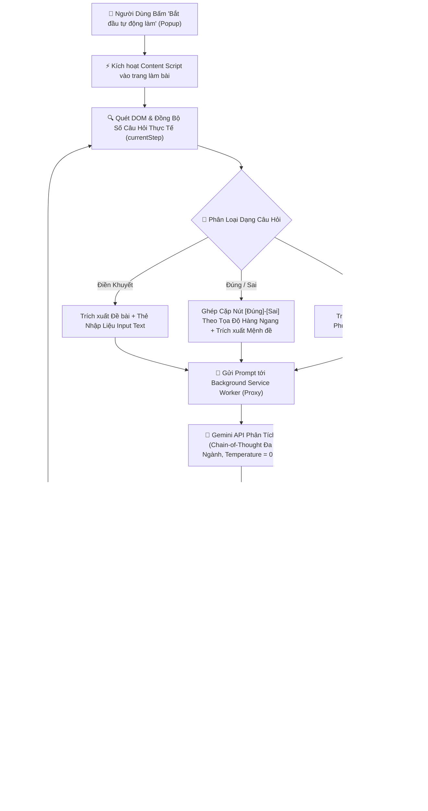

# EduX AI Quiz Solver - Chrome Extension (Manifest V3)

Tiện ích mở rộng Google Chrome (Manifest V3) hỗ trợ tự động giải bài tập và đề thi trực tuyến trên nền tảng **EduX (edux.cmcu.edu.vn)**. Sử dụng mô hình **Google Gemini AI** với cơ chế tư duy từng bước (Chain-of-Thought), tự động nhận diện cấu trúc DOM linh hoạt, mô phỏng thao tác người dùng và tự động chuyển câu hỏi mượt mà.

---

## ✨ Tính Năng Nổi Bật

- **Trắc nghiệm 4 lựa chọn (A, B, C, D)**: Tự động trích xuất nội dung đề thi, các phương án lựa chọn và click chọn đáp án chính xác nhất.
- **Trắc nghiệm Đúng / Sai đa mệnh đề (True/False - Chương trình GDPT mới & Đại học)**: Tự động ghép cặp tọa độ các nút `[ Đúng ]` và `[ Sai ]` theo từng dòng, phân tích học thuật từng ý (1, 2, 3, 4 hoặc a, b, c, d) và click chọn nút tương ứng.
- **Tự luận ngắn / Điền từ khuyết (Fill-in-the-blank)**: Tự động phát hiện ô text input, suy luận từ ngữ/thuật ngữ/đáp số chuẩn xác và điền vào ô với React Synthetic Events.
- **Tối ưu độ chính xác cao với Chain-of-Thought (CoT)**: AI phân tích lý thuyết, đối chiếu chuyên ngành và khử các bẫy ngữ nghĩa cực đoan trước khi đưa ra kết luận.
- **Đồng bộ hóa câu hỏi thời gian thực**: Tự động nhận diện câu hỏi hiện tại trên màn hình (dù bắt đầu từ câu 1 hay câu 23), không lo lệch tiến trình.
- **Mô phỏng thao tác người dùng (Anti-Detection)**: Tạo độ trễ ngẫu nhiên (1.5s - 3.5s) kèm hiệu ứng viền xanh trực quan, cuộn mượt (smooth scroll).
- **Giao diện sạch sẽ, không che khuất trang**: Đã loại bỏ hoàn toàn các banner nổi trên màn hình theo phản hồi người dùng; tiến trình được quản lý trực tiếp qua Popup tiện ích mà không làm vướng mắt.

---

## 🔄 Luồng Hoạt Động Chi Tiết (Workflow & Architecture)

### 📊 Sơ Đồ Khối Kiến Trúc



### 🧩 Chi Tiết 6 Giai Đoạn Hoạt Động

#### Giai đoạn 1: Kích hoạt & Kiểm tra an toàn
1. Khi người dùng mở đề thi EduX và bấm **"Bắt đầu tự động làm"** trên Popup, thông điệp `START_AUTO_SOLVE` kèm API Key được gửi đến `content.js`.
2. Tiện ích tự động xóa sạch các banner cũ nếu có, giữ cho trang web hoàn toàn sạch sẽ, không che khuất đề thi và nút bấm.

#### Giai đoạn 2: Bóc tách DOM & Đồng bộ câu hỏi thời gian thực
1. Tiện ích quét DOM hiện tại để tìm tiêu đề câu hỏi (`Câu X`, `Bài X`).
2. **Đồng bộ hóa tức thì**: Nếu người dùng đang mở sẵn Câu 23, biến tiến trình `currentStep` được đồng bộ ngay lập tức thành 23, ngăn chặn hiện tượng nhảy lệch câu hoặc lỗi không tìm thấy DOM.

#### Giai đoạn 3: Phân loại dạng bài thi thông minh
- **Dạng 1 - Trắc nghiệm nhiều lựa chọn**: Tìm các khối lựa chọn bắt đầu bằng `A.`, `B.`, `C.`, `D.` hoặc các thẻ radio/label.
- **Dạng 2 - Trắc nghiệm Đúng / Sai (Mới)**:
  - Quét toàn bộ các nút `[ Đúng ]` và `[ Sai ]` trên trang.
  - Sử dụng thuật toán **ghép cặp theo tọa độ dọc (`top`)**: Tự động ghép từng nút Đúng với nút Sai nằm trên cùng một hàng ngang.
  - Tìm phần tử cha chung (LCA) để bóc tách nội dung của từng mệnh đề học thuật.
- **Dạng 3 - Tự luận / Điền ô trống**: Tìm các thẻ `<input type="text">` hoặc `<textarea>` nhập câu trả lời.

#### Giai đoạn 4: Phân tích AI qua Background Service Worker
1. Giao tiếp qua `background.js` (Service Worker) để vượt qua chính sách CSP của EduX và tự động fallback giữa các model Gemini (`gemini-1.5-flash`, `gemini-2.0-flash`, `gemini-1.5-pro`...).
2. **Cơ chế Chain-of-Thought (CoT) Đa Ngành Toàn Diện**:
   - Thay vì ép trả lời ngay, AI được kích hoạt quy trình tư duy từng bước:
     - **Bài toán tính toán (Kế toán, Tài chính, Kinh tế, Thống kê)**: Tách bạch dữ kiện đề bài, lập công thức chuẩn (bình quân gia quyền, giá vốn hàng bán, số dư kho, chi phí biên, doanh thu biên...), thực hiện tính toán số học từng bước trước khi so sánh với 4 đáp án.
     - **Bài tập lý thuyết (Quản trị kinh doanh, Marketing, Pháp luật, Triết học...)**: Đối chiếu chặt chẽ với giáo trình đại học chuẩn, phân tích lý do sai của từng phương án bẫy để chọn phương án tối ưu.
   - Định dạng kết quả cuối cùng theo cấu trúc `[KẾT QUẢ]` để bộ parse trích xuất chính xác 100%.

#### Giai đoạn 5: Mô phỏng hành vi người dùng (Human Simulation)
1. Tạo độ trễ ngẫu nhiên từ **1.5s đến 3.5s** (tương đương tốc độ đọc và suy nghĩ của con người), tránh bị hệ thống giám sát nghi ngờ gian lận.
2. Kích hoạt toàn diện chuỗi sự kiện Synthetic Events:
   - `pointerdown` ➔ `mousedown` ➔ `pointerup` ➔ `mouseup` ➔ `click` ➔ `change` ➔ `input`.
   - Đảm bảo tương thích hoàn hảo với các framework hiện đại như React 18, Vue, Angular.
3. Làm nổi bật đáp án đã chọn bằng viền xanh ngọc dạ quang (`#10b981`) kèm bóng mờ.

#### Giai đoạn 6: Tự động chuyển câu (Auto-Navigation)
1. Sau khi hoàn thành câu hỏi, tiện ích tự động tìm nút **"Câu tiếp >"** hoặc nút số trang tiếp theo trên thanh pagination và kích hoạt click.
2. Xóa sạch các viền xanh cũ từ câu trước (tránh lưu vết do React tái sử dụng DOM).
3. Đợi DOM câu mới tải hoàn tất và lặp lại chu trình cho đến câu cuối cùng.

---

## 🎯 Giải Pháp Nâng Cao Độ Chính Xác Cho Trắc Nghiệm Đa Ngành

Trong thực tế thi cử đại học, các môn không thuộc CNTT như **Quản trị kinh doanh, Kế toán, Tài chính doanh nghiệp, Kinh tế học, Khoa học xã hội** thường khiến AI dễ trả lời sai (xác suất 50/50) nếu không có cơ chế suy luận trung gian:

1. **Khắc phục lỗi tính nhẩm của LLM (CoT Scratchpad)**:
   - Khi gặp các bài toán tính giá vốn hàng bán, đơn giá bình quân gia quyền hay điểm hòa vốn, prompt bắt buộc mô hình phải viết phép tính ra giấy nháp số học trước (ví dụ: `Đơn giá bình quân = 84.000.000 / 1.500 = 56.000 đ/sp` ➔ `Giá vốn = 1.000 * 56.000 = 56 triệu đồng`). Điều này triệt tiêu hoàn toàn lỗi "nhìn số đoán mò" (chọn nhầm phương án 54 triệu do xuất hiện tích 900 * 60 = 54 triệu).
2. **Hệ thống hóa kiến thức Quản trị & Kinh tế chuẩn**:
   - Tích hợp sẵn hệ thống quy tắc học thuật cho Quản trị kinh doanh (SWOT, Porter 5 forces, 4P/7P, Maslow, McGregor), Kế toán (kê khai thường xuyên vs kiểm kê định kỳ, FIFO, bình quân gia quyền, định khoản nợ/có), và Kinh tế học ($MR = MC$, độ co giãn, giá trần/sàn).
3. **Khử bẫy khẳng định tuyệt đối**:
   - Phân biệt rõ các khẳng định mang tính cực đoan ("chỉ cần", "luôn luôn", "tất cả", "không cần", "không bao giờ") trong câu hỏi lý thuyết để loại bỏ phương án sai.

---

## 📁 Cấu Trúc Dự Án

```
toolEdux/
├── manifest.json         # File khai báo Manifest V3 (quyền, host_permissions, scripts)
├── popup.html            # Giao diện người dùng điều khiển tiện ích
├── popup.css             # Định kiểu giao diện popup hiện đại Dark-mode
├── popup.js              # Xử lý lưu trữ Gemini API Key và giao tiếp với Content Script
├── content.js            # Script chính tiêm vào trang: bóc tách DOM, phân loại, giải bài, click đáp án
├── background.js         # Service Worker proxy gọi Gemini API, Auto-Fallback model, Keepalive
├── icons/                # Icon cho extension (16px, 48px, 128px)
├── demo_edux_quiz.html   # Trang web mô phỏng đầy đủ 3 dạng bài để kiểm tra offline
└── README.md             # Tài liệu dự án và hướng dẫn chi tiết
```

---

## 🚀 Hướng Dẫn Cài Đặt Vào Google Chrome

1. **Mở trình quản lý tiện ích**:
   - Mở Google Chrome và truy cập: `chrome://extensions/`
2. **Bật chế độ nhà phát triển (Developer Mode)**:
   - Gạt công tắc **"Chế độ dành cho nhà phát triển" (Developer mode)** ở góc trên bên phải sang **Bật**.
3. **Tải tiện ích vào Chrome**:
   - Bấm vào nút **"Tải tiện ích đã giải nén" (Load unpacked)** ở góc trên bên trái.
   - Chọn thư mục dự án: `c:\Users\LucasTUF\.antigravity-ide\toolEdux`.
4. **Ghim tiện ích**:
   - Bấm vào biểu tượng mảnh ghép (Extensions) trên thanh công cụ của Chrome và ghim **EduX AI Solver**.

---

## 🔑 Cách Lấy Google Gemini API Key Miễn Phí

1. Truy cập [Google AI Studio](https://aistudio.google.com/app/apikey).
2. Đăng nhập bằng tài khoản Google.
3. Bấm **"Create API key"** (Tạo khóa API).
4. Sao chép chuỗi khóa (bắt đầu bằng `AIzaSy...`).
5. Bấm vào icon tiện ích **EduX AI Solver** trên Chrome, dán API Key vào ô và bấm **"Lưu API Key"**.

---

## 🧪 Cách Kiểm Tra Nhanh Bằng File Demo

Dự án đã có sẵn file `demo_edux_quiz.html` mô phỏng giao diện chuẩn của EduX:
1. Mở file `demo_edux_quiz.html` bằng Google Chrome.
2. Nhấp vào icon **EduX AI Solver** trên thanh công cụ.
3. Bấm nút **"Bắt đầu tự động làm"**.
4. Bạn sẽ thấy tiện ích tự động giải qua cả 3 dạng bài: Trắc nghiệm truyền thống, Đúng / Sai đa mệnh đề, và Tự luận điền từ.

---

## 🛡️ Lưu Ý Quan Trọng
- Tiện ích này được phát triển phục vụ mục đích nghiên cứu công nghệ AI, học tập và hỗ trợ ôn luyện kiến thức.
- Hãy luôn tuân thủ quy chế thi cử và điều khoản dịch vụ của cơ sở giáo dục.
